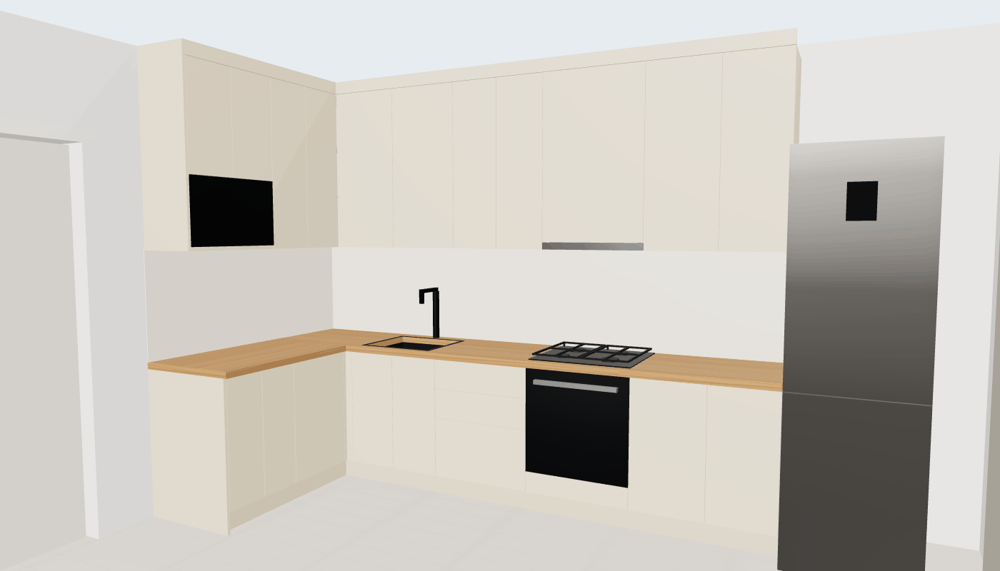
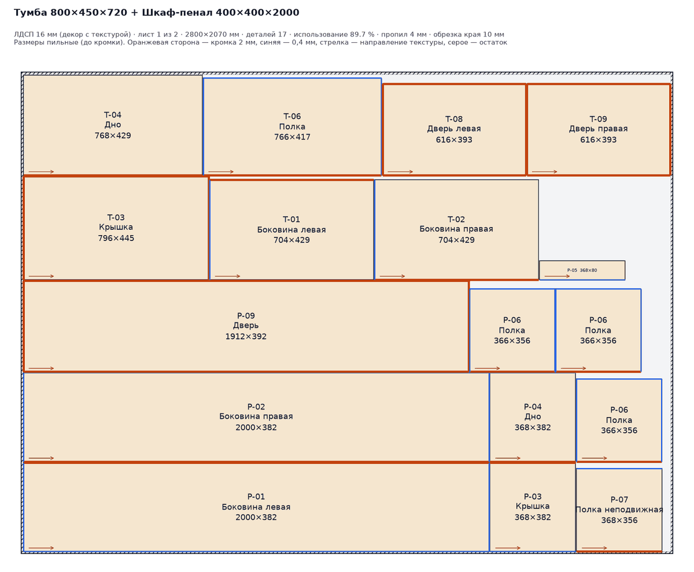

# mebel-cnc

[](https://github.com/Eljonio/mebel-cnc/actions/workflows/test.yml)

Parametric cabinet furniture for CNC panel processing, in Python. A product is described in a short YAML
file (overall size, materials, construction options); the program builds a 3D model out of panels, works out
edge banding and drilling (hinge cups, confirmat screws, cam locks, shelf pins), nests the parts on sheets
with kerf and trim, and writes layered DXF files, an Excel specification and a single-file 3D viewer.

Status: personal prototype. Not yet used for a real cut — see [Limitations](#limitations).



## Where to look first

| to check | open |
|---|---|
| the model: panels and fasteners from parameters, mating holes generated from one joint point | [`mebel/builder.py`](mebel/builder.py) |
| checks that look only at the finished geometry | [`mebel/checks.py`](mebel/checks.py) |
| nesting with kerf, trim, grain direction and a guillotine-cut check | [`mebel/nesting.py`](mebel/nesting.py) |
| every workshop number in one place, each marked as an assumption | [`shop/shop.yaml`](shop/shop.yaml) |
| what is tested | [`tests/`](tests) — 53 tests, `python -m pytest -q` |

**Provenance.** Exported on 2026-11-20 from a private working copy. A real order and its drawings were removed, so the public history starts with the export.

## Pipeline

```
YAML parameters ─► panels + fasteners ─► checks ─► parts (cut/finished size, edge band, drilling)
                                                         │
                     ┌───────────────────┬───────────────┼────────────────┬─────────────────┐
                     ▼                   ▼               ▼                ▼                 ▼
               sheet nesting      DXF per part     Excel spec      3D viewer (HTML)   ops JSON per sheet
               (kerf, trim,       and per sheet,   (parts, holes,  three.js, opens    (input for a future
               grain, guillotine) read back and    edge band,      from a file        machine-specific
                                  verified         hardware...)                       post-processor)
```

1. **Parameters.** `products/*.yaml` describes the product; `shop/shop.yaml` holds every workshop number
   (sheet size, kerf, trim, edge banding rules, hinge/confirmat/shelf-pin geometry). The code keeps no
   such numbers of its own, and each one is labelled as an assumption until a workshop confirms it.
2. **Model** (`mebel/builder.py`). Panels in global coordinates plus fasteners. All holes of one joint are
   generated from a single joint point, so mating holes (e.g. a confirmat in the side panel and in the
   bottom's edge) are coaxial by construction.
3. **Detailing** (`mebel/parts.py`). Each panel becomes a part in its own coordinates (X along the grain,
   looking at the machined face); finished size vs. cut size (edge band subtracted), banding per side,
   identical parts merged into one line.
4. **Checks** (`mebel/checks.py`). They look only at the finished geometry, not at the builder's formulas:
   dimension chains, panel intersections, facade gaps, holes (edge distance, breakthrough, overlap, clash
   with grooves), coaxiality of mating holes, hinges vs. shelves, part fits the sheet. On any error no
   files are written.
5. **Nesting** (`mebel/nesting.py`). [rectpack](https://github.com/secnot/rectpack) strategies are tried and the
   best result is kept, then checked by our own code: kerf between all parts, trim margin, grain direction,
   and that the layout can be cut with through cuts only (guillotine saw).
6. **Outputs** (`mebel/dxf_out.py`, `mebel/xlsx_out.py`, `mebel/cutmap.py`, `mebel/viewer.py`). Every DXF
   and the Excel file are read back and compared to the parts list.
7. **Post-processor** (`mebel/post/`). Only a guard: without a confirmed machine profile it raises
   `MachineNotConfigured` instead of producing G-code.

### Kitchen module

`mebel/kitchen/` builds a whole L-shaped kitchen from one config: room (walls, window, door, water/power/
vent points) and rows of modules (base, wall, corner, sink, oven, dishwasher, drawers, hood, microwave
niche, fillers, end panels, ceiling strip). It reuses the same panel engine for detailing and nesting
and adds kitchen checks: row lengths, heights, intersections with cut-outs, window and door clearances,
sink above the water outlet, hob under the vent, every hinged door opening 90° without hitting the
fridge or a neighbour, dishwasher niche, gas-hob clearances and valve access, socket positions,
microwave niche. Outputs: module/facade/spec tables (xlsx), plan and wall elevations (PNG/PDF), 3D HTML,
a Markdown report and, with `drilling: true`, drilling of carcasses and facades plus DXF by layers.
Appliance niche sizes in the examples come from public manufacturer installation manuals.

## Quick start

Python 3.10+ (tested with 3.12).

```bash
python3 -m venv .venv
.venv/bin/pip install -r requirements.txt
.venv/bin/python -m pytest -q                       # 53 tests, about a minute

.venv/bin/python -m mebel products/tumba-800.yaml   # base cabinet -> out/tumba-800/
.venv/bin/python -m mebel products/tumba-800.yaml products/penal-400.yaml   # one order, shared nesting
.venv/bin/python -m mebel.kitchen products/kuhnya-demo.yaml                 # kitchen -> out/kuhnya-demo/
```

`./run.sh` does the same in one go (creates `.venv`, runs the tests and the cabinet examples).

The 3D viewers are prebuilt in `viewer/dist/` (three.js bundled with esbuild). After editing `viewer/src/`
rebuild them with `npm install && npm run build && npm run build:kitchen`.

Optional extras, not covered by the tests: `--preview` (screenshots of the 3D view via headless Google Chrome,
software rendering), `--render` (Blender/Cycles renders on CPU, `.blend` and `.glb`) and a PDF handout.

## Example inputs

| file | what it is |
|---|---|
| `products/tumba-800.yaml` | base cabinet 800×450×720: overlay top on cam locks, one shelf, two doors, back panel nailed on |
| `products/penal-400.yaml` | tall cabinet 400×400×2000: inset top on confirmats, back panel in a groove, one door on 4 hinges, fixed shelf |
| `products/kuhnya-g.yaml` | L-shaped kitchen with handle profiles (Gola), corner wall unit with bi-fold door, induction hob |
| `products/kuhnya-demo.yaml` | L-shaped kitchen without handles (push-to-open), gas hob, built-in microwave, corner sink unit; drilling and DXF enabled |

All example sizes are made up.

## Output (`out/<product>/`)

| file | content |
|---|---|
| `specifikaciya.xlsx` | sheets: parts, drilling (every hole), edge banding (metres by type), hardware, sheets, checks, assumptions |
| `cutmap.pdf`, `cutmap/*.png` | cutting map per sheet with utilisation |
| `dxf/parts/*.dxf` | one file per part: contour, holes and grooves on separate layers |
| `dxf/sheets/*.dxf` | nested sheet with the parts in place |
| `ops/*.json` | per-sheet operations (drill / groove / contour) — input for a post-processor |
| `3d_<id>.html` | 3D viewer, opens from disk, no server |
| `summary.txt` | summary and all check results |

DXF layers: `CONTOUR`, `DRILL_V_D<d>_Z<depth>`, `DRILL_V_D<d>_THRU`, `DRILL_VB_…` (from the back face),
`DRILL_H_D<d>_Z<depth>` (into the edge), `GROOVE_W<width>_Z<depth>`, kitchen also `CUT_THRU` and
`POCKET_Z<depth>`; sheets add `SHEET`, `TRIM`, `LABELS` (not to be cut). Origin: lower-left corner of the
cut blank (before edge banding); a decimal point is written as `p` (`D7p5` = Ø7.5). Metadata (product,
material, thickness, origin, machine) goes into DXF custom properties, not into geometry.

Cutting map for the cabinet + tall cabinet order (sheet 1 of 2):



## Repository layout

```
mebel/            panel engine: builder, parts, checks, nesting, DXF/Excel/3D outputs, pipeline, CLI
mebel/kitchen/    kitchen layout, checks, drilling, drawings, reports, scene for 3D/Blender
mebel/post/       post-processor guard and machine profile template
shop/shop.yaml    workshop numbers (all marked as assumptions)
products/         example inputs
tests/            pytest suite
tools/            headless screenshot script, Blender scene builder, DXF atlas
viewer/           three.js viewers (src + prebuilt bundles)
```

## Limitations

- **Never tested on a real machine.** No part has been cut from these files yet. The DXF output is meant
  for review and for import into the machine's CAM software.
- **No G-code.** The target machine and its controller are unknown, so no machine-specific post-processor
  was written; `mebel/post` deliberately refuses to produce a program.
- **Workshop numbers are assumptions.** Sheet size, kerf, edge banding rules and hardware geometry are
  typical values and must be confirmed for a specific workshop and hardware brand.
- **Scope.** Rectangular panels only (no curved parts, no free-form nesting). The generic builder makes
  box carcasses (sides, top overlay/inset, bottom, plinth, shelves, 0–2 hinged doors, back panel overlay or
  in a groove); the kitchen uses a fixed set of module types. Drawer boxes are sized by catalogue formulas,
  not modelled in detail. No prices.
- **Language.** User-facing text (reports, Excel, drawings) and most comments are in Russian; identifiers
  are in English.

## License

MIT, see [LICENSE](LICENSE). Dependencies: ezdxf, openpyxl, PyYAML (MIT), rectpack (Apache-2.0),
matplotlib (PSF-based), three.js and esbuild (MIT).
